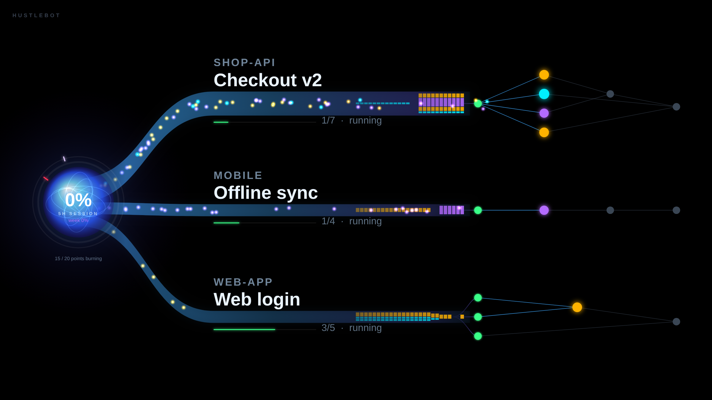
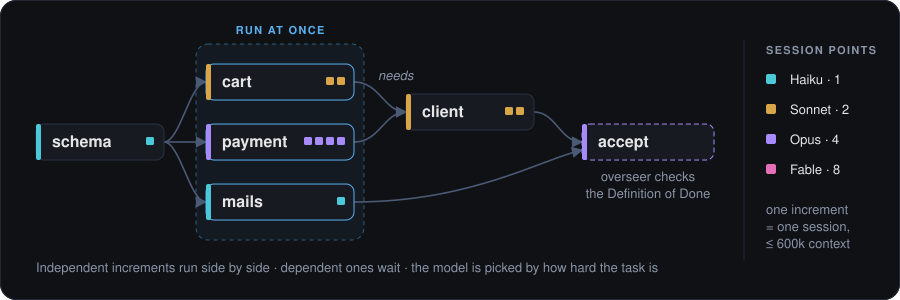
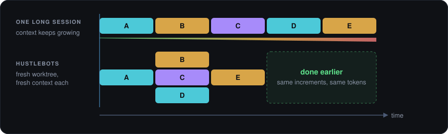
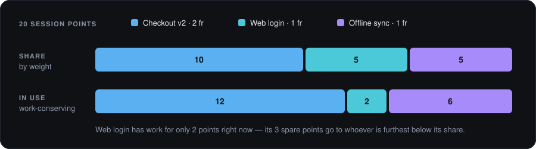
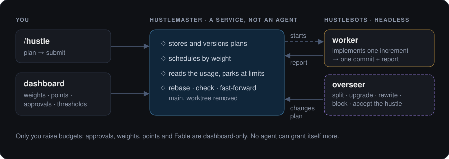
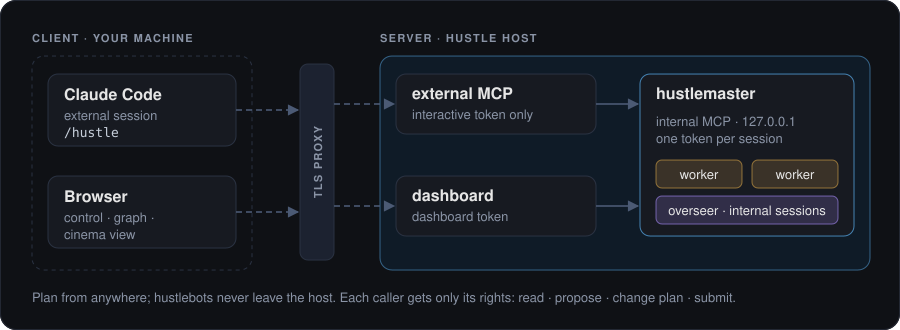
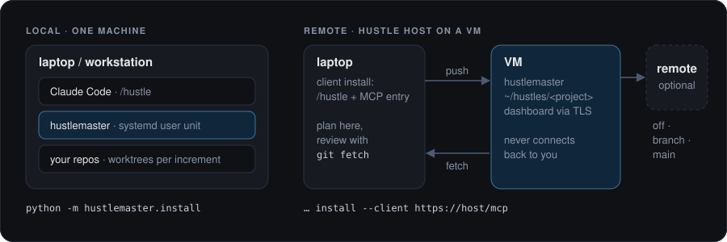

<div align="center">


# hustlebot

**Give Claude Code a goal. hustlebot plans it, works it in parallel headless sessions and merges only verified results — across usage limits, on your subscription.**

Dependency plans · parallel increments within a hustle · parallel hustles by weight · local or on a VM

</div>





## What makes it different

### 1 · Plans, not loops
`/hustle` interviews you, then cuts the goal into **increments**: one task each, dependencies only where one needs another, and a **model per increment** picked by how hard it is. Every plan ends with an overseer that checks the Definition of Done.



### 2 · Parallel inside one hustle
Independent increments run **at the same time**, each as its own session in its own git worktree with a fresh context. Same work, same tokens — finished sooner.



### 3 · Many hustles, weighted
Run several goals at once, across repositories. Each active hustle gets a share of the machine's **session points** by its weight; points one cannot use go to the others.



### 4 · hustlemaster and hustlebots
The **hustlemaster** is a plain service, not an agent: it stores the plans, reads `/usage`, schedules and merges. **hustlebots** are headless Claude Code sessions: workers implement one increment, overseers reshape the plan. The budget stays with you.



### 5 · Client and server
Your interactive Claude Code sessions are **clients**: they plan, read and change hustles over MCP, from any machine. The hustlebots are **internal sessions** on the host, each with its own token and only its own rights.



### 6 · Local or on a VM
Run everything on your workstation, or put the hustlemaster on a VM and plan from your laptop. The host never connects back: you push the starting commit and fetch the results.



## Quick start

Linux with systemd, [`uv`](https://docs.astral.sh/uv/) and Claude Code logged in to a subscription.

```sh
git clone https://github.com/juliantrude/hustlebot
git clone https://github.com/juliantrude/graph-engine   # the graph view, beside it
cd hustlebot && uv run --project master --no-dev python -m hustlemaster.install
loginctl enable-linger "$USER"                           # keep running after logout
```

Then, in any project, run **`/hustle`** and activate the hustle in the dashboard at `http://127.0.0.1:8770`.

**On a VM:** the same install on the VM (with `--bind`, `--mcp-bind` and `--mcp-name` behind a TLS proxy), then on your laptop:

```sh
uv run --project master --no-dev python -m hustlemaster.install \
  --client https://<host>/mcp --token <interactive-token>
```

## More

- [`master/README.md`](master/README.md) — install flags, the dashboard, scheduling, approvals, rights, security
- [`docs/adr/`](docs/adr/) — the design decisions (ADR 0008–0016 for v2)
- [`CONTEXT.md`](CONTEXT.md) — the glossary
- [`docs/v1-loop.md`](docs/v1-loop.md) — the old single-chain loop and how to migrate from it

> ⚠️ hustlebots run unattended with full tool access in their worktrees. Point the hustlemaster only at projects where you accept that.

The grilling interview behind `/hustle` is adapted from [Matt Pocock](https://github.com/mattpocock)'s grilling skill. MIT licensed.
